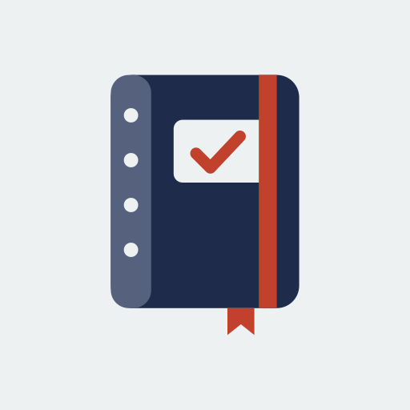

  

<h1 align="center">KakeiboOK</h1>

  <a href="#deutsch">Deutsch</a> · <a href="#english">English</a>

---

## Deutsch

**KakeiboOK** ist ein Haushaltsbuch nach der japanischen **Kakeibo-Methode** (家計簿, „Haushaltsbuch“). Der Name verbindet *Kakeibo* mit einem *OK* für deine Finanzen, und zusammen steckt darin auch ein *Book*.

👉 **App öffnen:** https://DEINNAME.github.io/kakeibook/

### Was ist Kakeibo?

Kakeibo wurde 1904 von der japanischen Journalistin Hani Motoko entwickelt. Die Idee: Wer seine Ausgaben bewusst aufschreibt und regelmäßig darüber nachdenkt, gibt automatisch weniger aus. Jeder Monat beginnt mit einem Plan und endet mit vier Fragen:

1. Wie viel Geld habe ich?
2. Wie viel möchte ich sparen?
3. Wie viel gebe ich aus?
4. Wie kann ich mich verbessern?

### Funktionen

- **Monatsplan:** Einnahmen, Fixkosten und Sparziel eintragen und sehen, wie viel frei verfügbar ist.
- **Vier Kategorien:** Überleben 生, Optional 選, Kultur 文 und Extras 外.
- **Übersicht:** Ausgegebenes, verbleibendes Budget pro Tag und eine Hochrechnung bis Monatsende.
- **Woche für Woche:** Ausgaben pro Woche, wie es die Kakeibo-Methode vorsieht.
- **Spartipps:** Die App erkennt zum Beispiel Lieferdienste, Abos, Kaffee unterwegs oder Verträge und gibt passende Hinweise.
- **Monatsreflexion:** die vier Kakeibo-Fragen mit Platz für eigene Notizen.
- **Datensicherung:** Einträge als Datei sichern, wieder einlesen oder als Tabelle (CSV) exportieren.
- **Zweisprachig:** Deutsch und Englisch, mit Auswahl der Währung.
- **Offline:** Nach dem ersten Öffnen funktioniert die App auch ohne Internet.

### Auf dem Handy installieren

**iPhone:** Link in Safari öffnen → **Teilen** → **Zum Home-Bildschirm**.
**Android:** Link in Chrome öffnen → Menü **⋮** → **App installieren** oder **Zum Startbildschirm hinzufügen**.

KakeiboOK erscheint dann mit eigenem Icon und startet wie eine normale App.

### Datenschutz

Alle Einträge bleiben **ausschließlich auf deinem Gerät**. Es gibt kein Konto, keine Cloud, keine Cookies, kein Tracking und keine Werbung. Details stehen in der [Datenschutzerklärung](datenschutz.html).

### Technik

Eine Progressive Web App (PWA) aus reinem HTML, CSS und JavaScript, ohne Frameworks und ohne externe Abhängigkeiten. Daten werden im `localStorage` des Browsers gespeichert, ein Service Worker sorgt für den Offline-Betrieb.

### Hinweis

KakeiboOK gibt allgemeine Spartipps und ersetzt keine Finanzberatung.

[Impressum](impressum.html) · [Datenschutz](datenschutz.html)

---

## English

**KakeiboOK** is a household ledger based on the Japanese **Kakeibo method** (家計簿, "household account book"). The name combines *Kakeibo* with an *OK* for your finances, and together it also spells *Book*.

👉 **Open the app:** https://DEINNAME.github.io/kakeibook/

### What is Kakeibo?

Kakeibo was created in 1904 by Japanese journalist Hani Motoko. The idea: if you consciously write down your spending and reflect on it regularly, you naturally spend less. Every month starts with a plan and ends with four questions:

1. How much money do I have?
2. How much do I want to save?
3. How much am I spending?
4. How can I improve?

### Features

- **Monthly plan:** enter income, fixed costs and a savings goal, and see what is free to spend.
- **Four categories:** Survival 生, Optional 選, Culture 文 and Extras 外.
- **Overview:** money spent, budget left per day and a month-end forecast.
- **Week by week:** spending per week, as the Kakeibo method suggests.
- **Saving tips:** the app spots things like food delivery, subscriptions, coffee on the go or contracts and gives matching advice.
- **Monthly reflection:** the four Kakeibo questions with space for your own notes.
- **Backup:** save your entries as a file, restore them, or export a table (CSV).
- **Bilingual:** English and German, with a choice of currency.
- **Offline:** after the first visit the app works without an internet connection.

### Install on your phone

**iPhone:** open the link in Safari → **Share** → **Add to Home Screen**.
**Android:** open the link in Chrome → menu **⋮** → **Install app** or **Add to Home screen**.

KakeiboOK then appears with its own icon and opens like a regular app.

### Privacy

All entries stay **only on your device**. No account, no cloud, no cookies, no tracking and no ads. See the [privacy policy](privacy.html) for details.

### Tech

A Progressive Web App (PWA) built with plain HTML, CSS and JavaScript, with no frameworks and no external dependencies. Data is stored in the browser's `localStorage`, and a service worker handles offline use.

### Disclaimer

KakeiboOK offers general saving tips and is not financial advice.

[Legal notice](legal-notice.html) · [Privacy](privacy.html)
